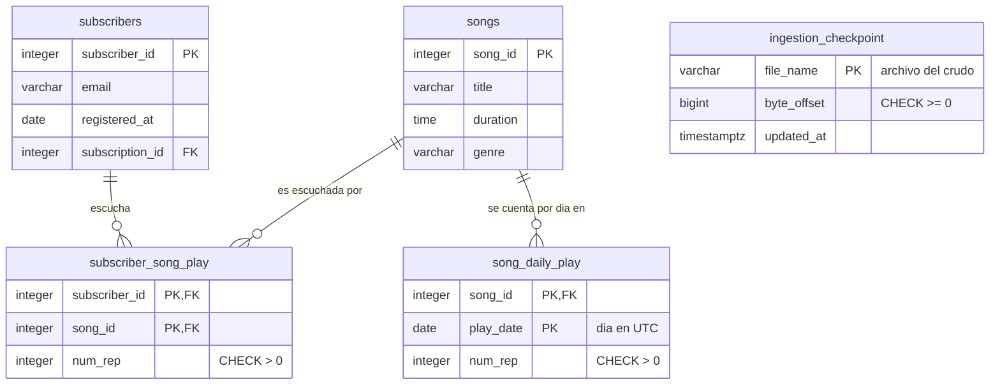

# Diagrama ER: tablas de la Tarea 4

Complementa `diagrama_er.png`: muestra las tablas nuevas y su relación con las tablas de la
Tarea 3 que ya existían (`subscribers` y `songs`; las demás no cambian). GitHub dibuja el
diagrama a partir del código.

Las tres tablas se crean en `db/03_play_counts.sql`.

| Tabla | Para qué |
|---|---|
| `subscriber_song_play` | Reproducciones válidas de cada suscriptor por canción, desde siempre: las 20 más escuchadas de un suscriptor |
| `song_daily_play` | Reproducciones válidas de cada canción por día (UTC): el top 100 semanal |
| `ingestion_checkpoint` | Hasta qué byte de cada archivo del crudo ya contó el processor. No se relaciona con otras tablas y no guarda mensajes |

Cardinalidades: un suscriptor tiene 0 o más filas en `subscriber_song_play` y cada fila es de
exactamente un suscriptor y una canción. Una canción tiene 0 o más filas en `song_daily_play`, una
por día con reproducciones. `song_daily_play` no tiene suscriptor: por eso eliminar a un
suscriptor no cambia el top semanal.
